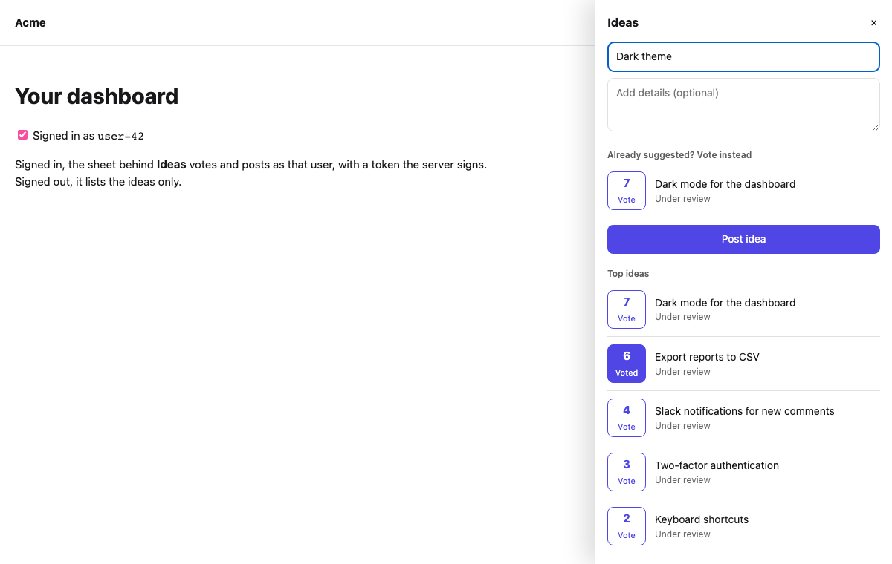
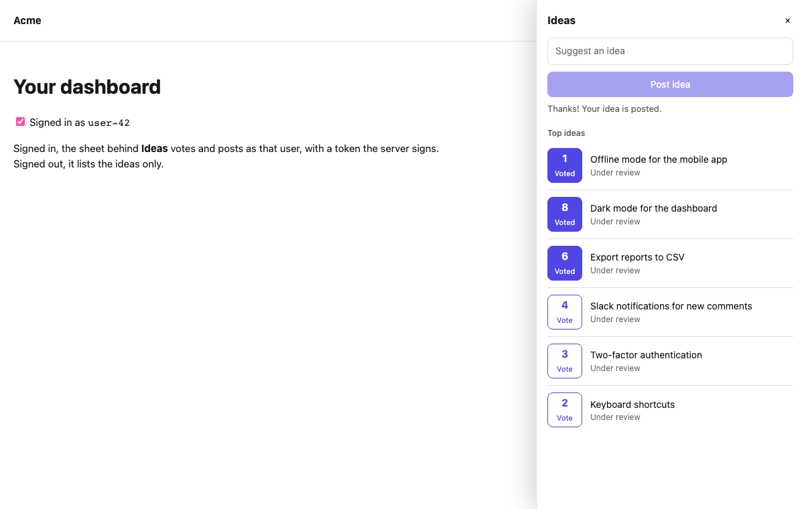
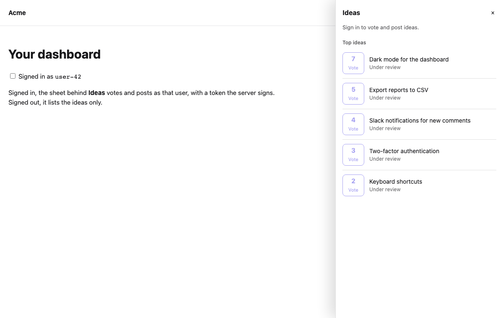

# Collect ideas in your app

Your users have ideas while they use your app, not while they browse your website. The feedback sheet brings a board into the app: it lists the most voted ideas, lets a signed-in user vote, and takes a new idea. While they type a title, ideas like it appear first, so a user who finds theirs votes for it instead of posting it again.



## 1. Before you start

- A public feedback board (see [Open a public feedback board](./public-board.md)). The app reads it by its slug, such as `ideas`.
- A **publishable key** for the project (**Settings → API keys**) with `feedback:read` and `feedback:write`. A publishable key is safe to ship in an app.
- Signed-in users, told apart by a token your server signs: an HS256 JWT signed with the project's identity secret, the user's id as `sub`, expiring within an hour. It is the same token the [public board](./public-board.md#3-sign-your-users-in-from-your-app) and the ["what's new" badge](./whats-new.md#2-signed-in-users-and-visitors) use. Without it, the sheet lists the ideas and says that users must sign in to vote or post.
- For a web app, its address registered as a **web origin** of a web app in the project (**Settings → Apps**).

## 2. On the web

Install the browser SDK and mount the sheet on a button of your page. Clicking the button opens the sheet at the side of the page; Escape or the close button closes it.

```bash
npm install @mocco/js
```

```ts
import { createFeedbackSheet } from '@mocco/js/feedback-sheet';

const ideas = createFeedbackSheet({
  publishableKey: 'mk_pub_…',
  board: 'ideas',
  // Return null while nobody is signed in: the sheet is then read-only.
  endUserToken: async () => {
    const response = await fetch('/api/mocco-token');
    return response.ok ? ((await response.json()) as { token: string }).token : null;
  },
});

ideas.mount('#ideas-button');
```

Signed in, the user votes with the button next to each idea (pressing it again takes the vote back) and posts an idea with the box at the top. A new idea starts **under review** with the author's vote and goes to the top of the list.



A visitor without a token sees the same list, read-only:



Options for `mount`:

| Option | What it does |
|---|---|
| `labels` | The sheet's words, such as `title` (the board's name by default), `submit`, `similar`, `signIn`, `statuses` (one per post status) and `votes` (a function that says a count for screen readers) |
| `categoryId` | Post new ideas in one of the board's categories |
| `onOpenChange` | Called with `true` or `false` when the sheet opens or closes, for example for analytics |

`mount` returns a function that removes the sheet again. To change the colors, set `--mocco-fs-accent` (the vote and post buttons), `--mocco-fs-bg`, `--mocco-fs-fg` and `--mocco-fs-border` on your page; the sheet follows the system's dark mode by default. Every text, including what users write, is shown as text, so nothing in a post runs as code on your page.

The sheet, with the client it needs, is about 6 KB gzipped in a bundled app; Mocco's checks keep it under 25 KB.

## 3. In React Native

Install the React Native SDK (it runs in Expo Go):

```bash
npx expo install @mocco/react-native
```

Create one sheet for the app, outside your components, and open `<FeedbackSheet />` from any button. It is a modal page sheet; it loads the board each time it opens.

```tsx
import { useState } from 'react';
import { Button } from 'react-native';
import { createFeedbackSheet, FeedbackSheet } from '@mocco/react-native/feedback';

export const ideas = createFeedbackSheet({
  publishableKey: 'mk_pub_…',
  board: 'ideas',
  endUserToken: async () => await fetchMoccoTokenFromYourServer(),
});

export function IdeasButton() {
  const [isOpen, setIsOpen] = useState(false);
  return (
    <>
      <Button title="Ideas" onPress={() => setIsOpen(true)} />
      <FeedbackSheet sheet={ideas} visible={isOpen} onClose={() => setIsOpen(false)} accentColor="#4f46e5" />
    </>
  );
}
```

`FeedbackSheet` takes `labels` (the same words as on the web), `accentColor` and `categoryId`. To draw the screen in your own design instead, `useFeedbackSheet(ideas)` gives the same state and actions: `posts`, `votes`, `isSignedIn`, `draft` (with `similar`), `toggleVote(postId)`, `setDraft({ title, body })` and `submit()`. It sits well next to the [messenger](../messenger/contact-us.md) on a "Help & feedback" screen, since both use the same signed-in user.

## 4. Draw your own, or go further

The sheet is built on `FeedbackClient`, which you can use directly (`@mocco/js/feedback` on the web, `FeedbackClient` from `@mocco/react-native/feedback`):

```ts
import { createFeedback } from '@mocco/js/feedback';

const feedback = createFeedback({ publishableKey: 'mk_pub_…', endUserToken: fetchMoccoToken });
const board = feedback.board('ideas');

const similar = await board.similar('Dark theme'); // up to 5 posts like the title
const post = await board.createPost({ title: 'Dark theme', body: 'For late nights.' });
await feedback.comment(post.id, 'Also for the mobile app, please.');
const { comments } = await feedback.comments(post.id); // isMine marks the user's own
await feedback.unfollow(post.id); // voting or posting follows a post; this opts out
const roadmap = await board.roadmap(); // { planned, in_progress, shipped }
```

Every write needs a signed-in user: without a token it is refused with a `MoccoError` whose `code` is `missing_end_user_token`, before anything is sent.

## 5. Example apps

- **Web.** `examples/web-feedback` in the [Mocco repository](https://github.com/fi-workers/mocco/tree/main/examples/web-feedback) is a static page with a "What's new" badge and an "Ideas" sheet, and a small Node server (no dependencies) that signs the end-user token, as your server would. Its README says how to run it against your project.
- **Expo.** The code in section 3 is the whole integration: put `IdeasButton` on any screen of an Expo app (`npx create-expo-app`, then `npx expo install @mocco/react-native`), and have `fetchMoccoTokenFromYourServer` call your server's token endpoint.

## 6. Limits

A signed-in user can post 5 ideas, vote 30 times and comment 20 times an hour; the similar-ideas search runs at most 60 times a minute from one address, which typing in the sheet stays under, since it waits until typing pauses. The list shows the 20 most voted ideas.

The board's list doesn't say which ideas a user voted for before, so after the sheet reopens it shows those as not voted. Pressing **Vote** on one of them changes nothing on Mocco: the count stays, and the button turns to **Voted**.
