# Open a public feedback board

A feedback board collects what your users want next. On its public page they read the ideas others posted, vote for the ones they want, comment, and post their own. Your team sees the same posts in Mocco, answers them and moves them from under review to planned, in progress and shipped.

## 1. Before you start

The public board is served on your project's help center site, so the project needs one (see [Publish a help center](../help/help-center.md); the site doesn't need any articles). A board whose site is `showyourtime.help.mocco.club` is at:

```text
https://showyourtime.help.mocco.club/feedback/<board>
```

When the help center has its own domain, such as `help.showyourtime.app`, the board is there too: `https://help.showyourtime.app/feedback/<board>`.

## 2. Create a board

Turn on **Feedback board** on the workspace's **Products** page. The project then has a **Feedback** section. A project without boards opens on the form for its first one: give it a name, and its address follows the name (`Feature requests` → `/feedback/feature-requests`) unless you change it.

**Manage boards** lists every board with its public address. There you rename a board, change its address, make it private, delete it, and add or rename its categories. Users pick a category when they post, and the board and roadmap filter by it. Deleting a category keeps its posts, uncategorized.

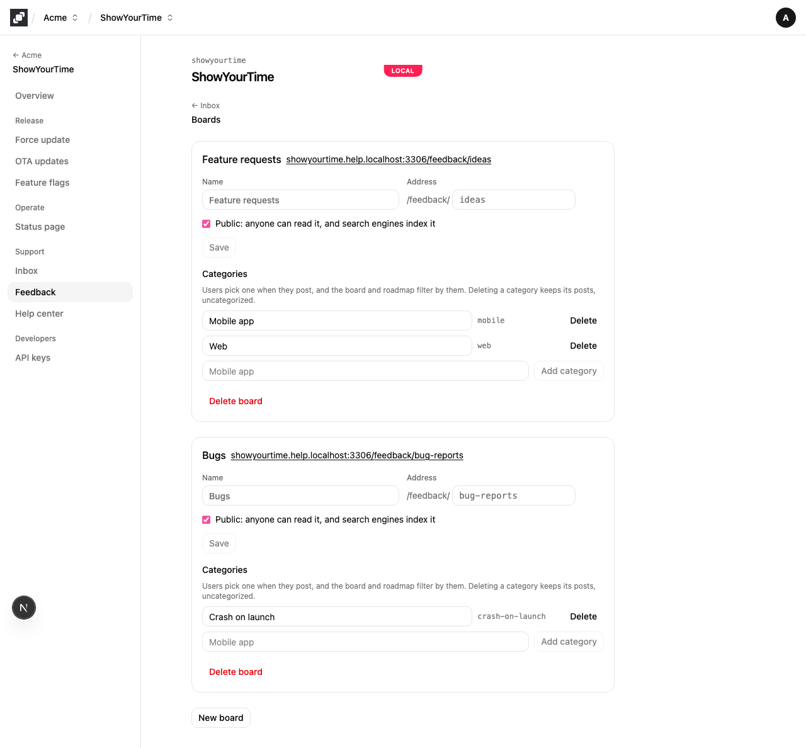

Boards are public when they are created. A board marked private has no public page. Changing a board's address changes its public link, so links shared before stop working.

## 3. What visitors see

The board lists its posts, most voted first. Anyone can read it, and search engines index it. Each post shows its votes, its status and how many comments it has.

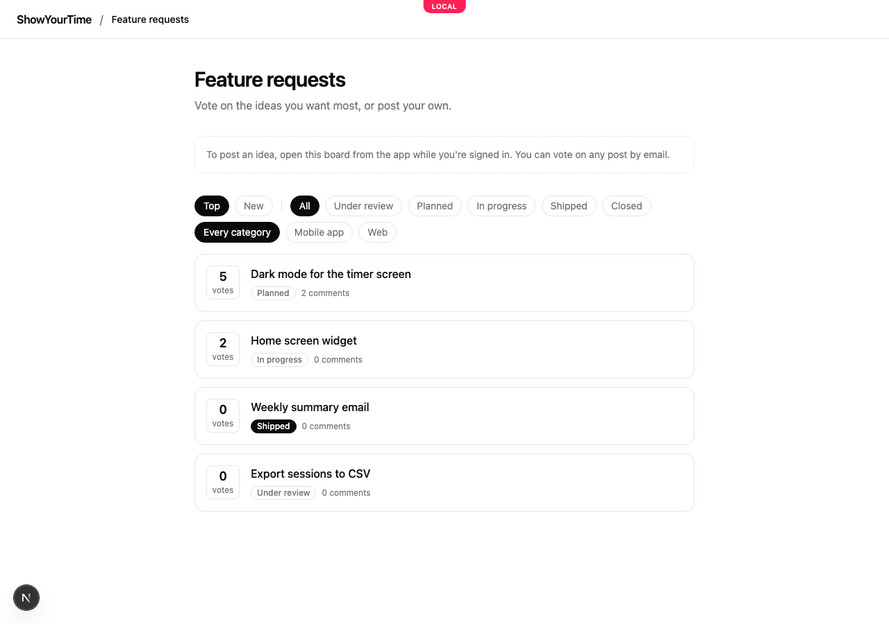

**Top** and **New** sort the list. The status and category buttons filter it, and the filter is kept in the address (`?status=planned&category=mobile`), so a filtered list can be shared as a link. Duplicates your team merged into another post are left out.

A post's page has its description, the team's official response, and the public comments. Your team's internal notes never appear on the public page, and comments never show who wrote them: they read "Official response", "The team", "A user", or "You" for the reader's own.

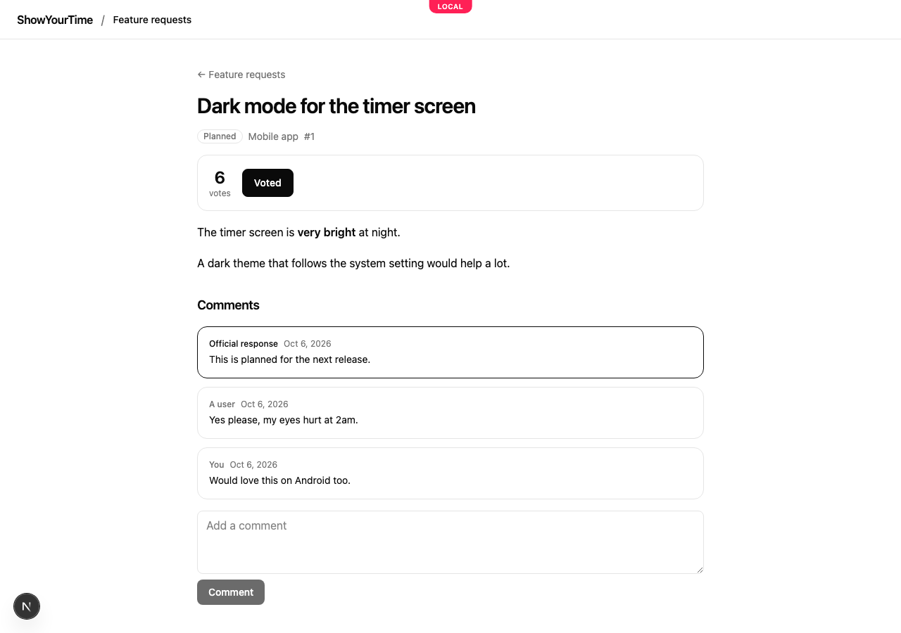

A merged duplicate's address sends the reader to the post it was merged into.

The board's **Roadmap** page, at `/feedback/<board>/roadmap`, shows what your team has planned, is building and has shipped, side by side. Each column lists its most voted posts first, up to 50. Moving a post to planned, in progress or shipped in Mocco puts it on the roadmap; under review and closed posts stay off it. The category buttons narrow the columns, and the choice is kept in the address (`?category=mobile`).

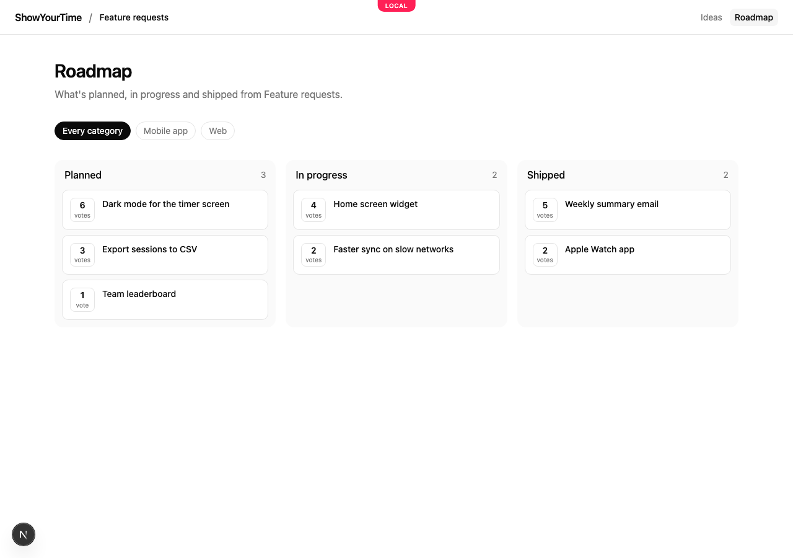

The **Changelog** page, at `/feedback/<board>/changelog`, is where you announce what shipped. Each entry has a date, tags (New, Improved, Fixed), its text and the ideas it shipped, and each of those ideas then shows **Shipped in** with a link back. Only published entries appear. Readers can follow it in a feed reader at `/feedback/<board>/changelog.rss`.

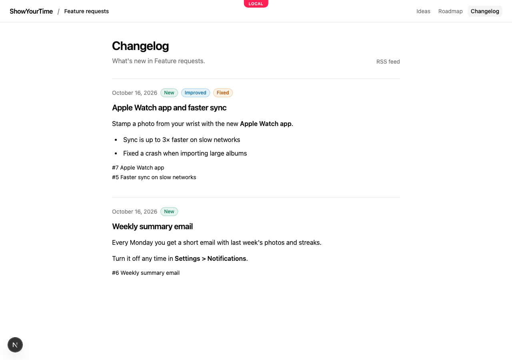

Search engines find the board, its roadmap, its changelog and every post through the help center's sitemap (`/sitemap.xml`), so you don't submit them yourself.

## 4. Sign your users in from your app

Posting and commenting need to know who the user is. Your app's server signs a short-lived token for its signed-in user, the same token your app sends to the feedback API (see [In-app contact with Mocco Messenger](../messenger/contact-us.md) for the identity secret). It is an HS256 JWT signed with the project's identity secret (the one Messenger setup shows), with the user's id as `sub` and an expiry at most an hour ahead.

Link to the board with the token in the address:

```ts
import { SignJWT } from 'jose';

// On your server, for the signed-in user.
const now = Math.floor(Date.now() / 1000);
const token = await new SignJWT({})
  .setProtectedHeader({ alg: 'HS256' })
  .setSubject(user.id)
  .setIssuedAt(now)
  .setExpirationTime(now + 15 * 60)
  .sign(new TextEncoder().encode(process.env.MOCCO_IDENTITY_SECRET));

const boardUrl = `https://showyourtime.help.mocco.club/feedback/ideas?token=${token}`;
```

The page keeps the token for that browser tab and removes it from the address, so it isn't bookmarked or passed on. When the token expires, the user follows the link from your app again.

A signed-in user can post an idea. While they type a title, the board shows similar posts, so they can vote on one of those instead of posting a duplicate. A new post starts **Under review** with the author's own vote.

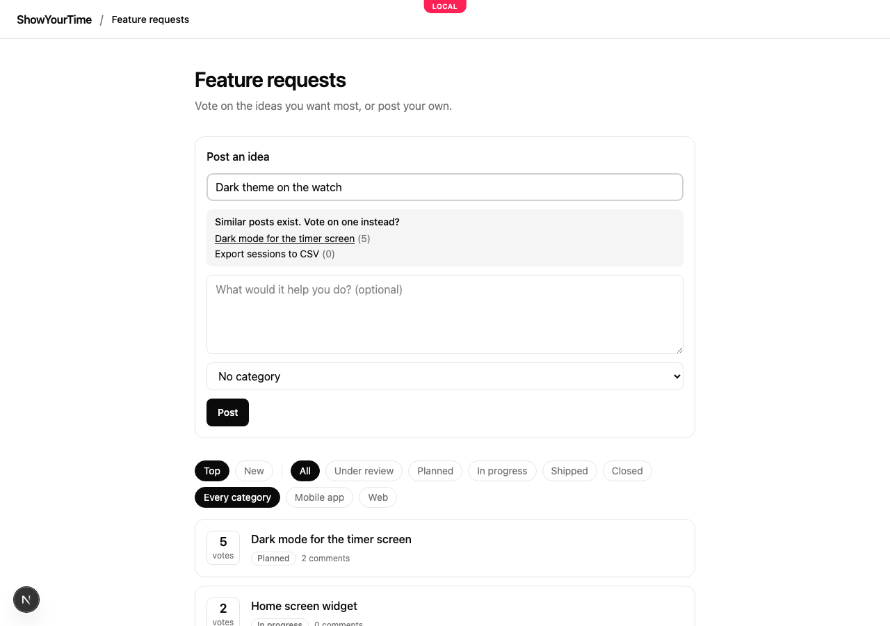

On a post, a signed-in user votes with one click, and clicking again takes the vote back. The count updates at once. They can also comment.

## 5. Visitors without an account

Someone your app hasn't signed in can still vote, with their email address. Mocco mails them a link, and the vote counts once they open it. They can't post or comment.

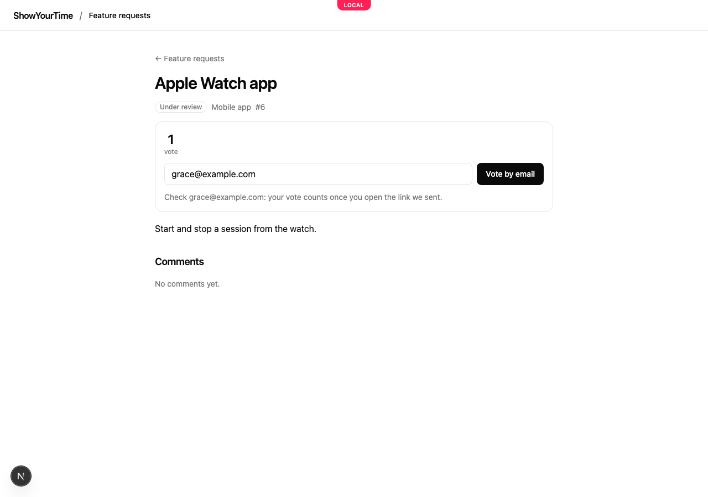

Voting by email needs Mocco to send mail. On a self-hosted Mocco without an email sender, the form says it isn't available.

People who voted by email also hear when the post moves: Mocco mails them when it becomes planned, in progress, shipped or closed. A shipped mail links the changelog entry it went out in. Each mail goes out two minutes after the change, so you can undo a slip. If the post moves again within those two minutes, only the newest status is mailed, and moving a post back to under review mails no one. Every mail has a one-click unsubscribe link. Mocco doesn't mail people your app signed in, because it doesn't keep their addresses. Your app can tell them itself.

## 6. Triage in the inbox

The **Feedback** section opens on the inbox: one board's posts, under review and newest first. Pick another board, a status (or **All**), a category and an order (**Newest**, **Most voted** or **By status**). The choice stays in the address, so you can bookmark a view or send it to a teammate. Each post shows its votes, its number on the board, its status, how many public comments it has and whether your team or a user posted it. The list refreshes every 30 seconds while open.

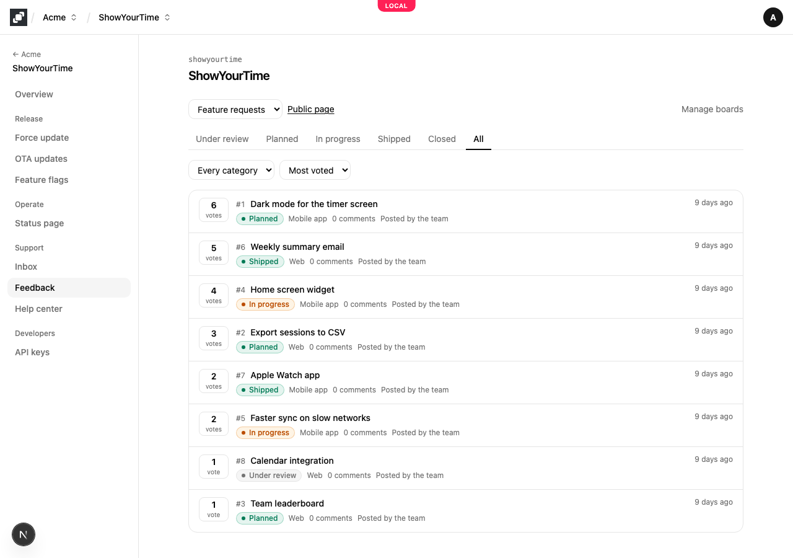

Open a post to work on it:

- **Status** moves it along. Everyone following it hears about the change, and planned, in progress and shipped posts appear on the roadmap.
- **Category** files it, or **No category** takes it out of one.
- **Comment** in one of three ways. A **Reply** is public. The **Official response** is your team's answer, highlighted among the public comments. An **Internal note** stays in Mocco, and visitors never see it.
- **Votes** lists who voted. A pending vote waits for its email to be confirmed. When a user asks for something by email or on a call, record their vote with the id your app knows them by.
- **Merge into another post…** handles duplicates. Search the board by title or number and pick the post to keep. The duplicate's votes and followers move there, each person counted once, and the duplicate's public address sends readers to it.

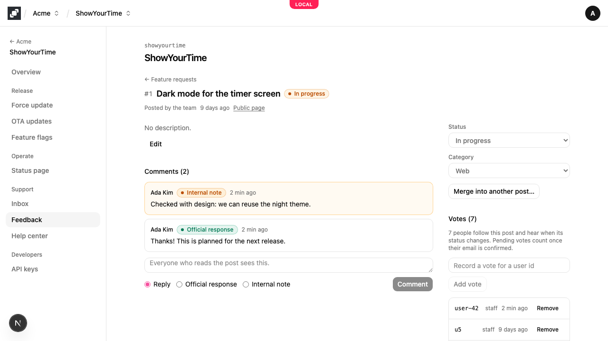

### Turn a conversation into feedback

When a user asks for something in the Messenger inbox, open the conversation and choose **Convert to feedback** in the panel beside it. Mocco fills in a title and details from what they wrote and shows posts on the board that may already cover it. **Add to #N** adds the request to one of those; **Create post** makes a new one. A signed-in user's vote is added for them, so they hear when it moves. The post's page shows the conversations it came from, with a link back to each.

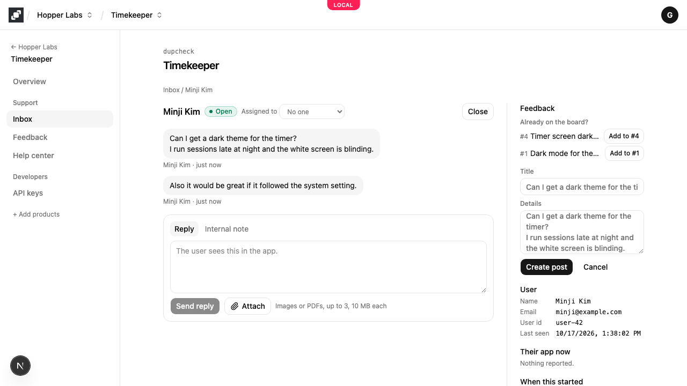

### Possible duplicates

Mocco compares each new post with the board's older ones, within a minute or so of its arrival. When most of the words in its title are in an older post's title, or (where an embedding model is set up) the two posts mean much the same in other words, the pair shows up under **Possible duplicates** in the inbox's header, with how many are waiting. For each pair, **Merge** folds the newer post into the older one (the same as **Merge into another post…**), and **Not the same** sets the pair aside so it isn't suggested again.

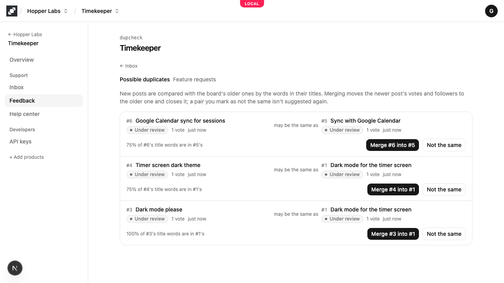

### Link GitHub issues and pull requests

Tie a post to the work that delivers it. On the post's page, under **GitHub**, choose **Link an issue or pull request…**, pick one of the repositories linked to the project, choose **Issue** or **Pull request**, and search by words or by number (`#128`). Click a result to link it. Each link shows whether it is open, closed or merged, with the merge commit once merged; a linked issue also lists the pull requests that close it. Mocco keeps these up to date as things change on GitHub, so you don't need to come back and refresh them. **Unlink** removes one.

Only repositories linked to the post's project can be searched or linked; link a repository on the project's page first. If you installed the Mocco GitHub App before linking was available, GitHub asks an owner of your organization to accept two read-only permissions (Issues and Pull requests): look for **Review request** on the App's installation page in your GitHub settings. Until then, searching issues fails.

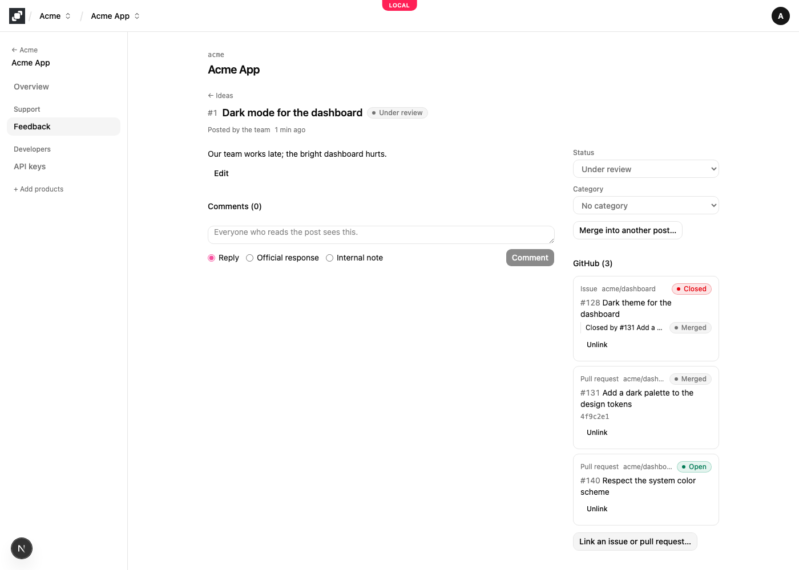

### Mark posts shipped when they release

Mocco can tell you when the work behind a post is live. On **Manage boards**, under **Shipping on release**, pick the **Release repository**: the repository whose releases put this board's features in front of users. A release is a run of that repository's pipeline that succeeded and passed an approval gate, so a run with no gate never ships anything. If the same pipeline deploys to more than one place, name the step that deploys to your users under **Release step** (for example `deploy-production`), and only runs that finished that step count. Then choose when a post counts as shipped: when **every** linked issue and pull request has shipped, or when **any** one has. A pull request closed without merging, or an issue closed without one, doesn't hold a post back.

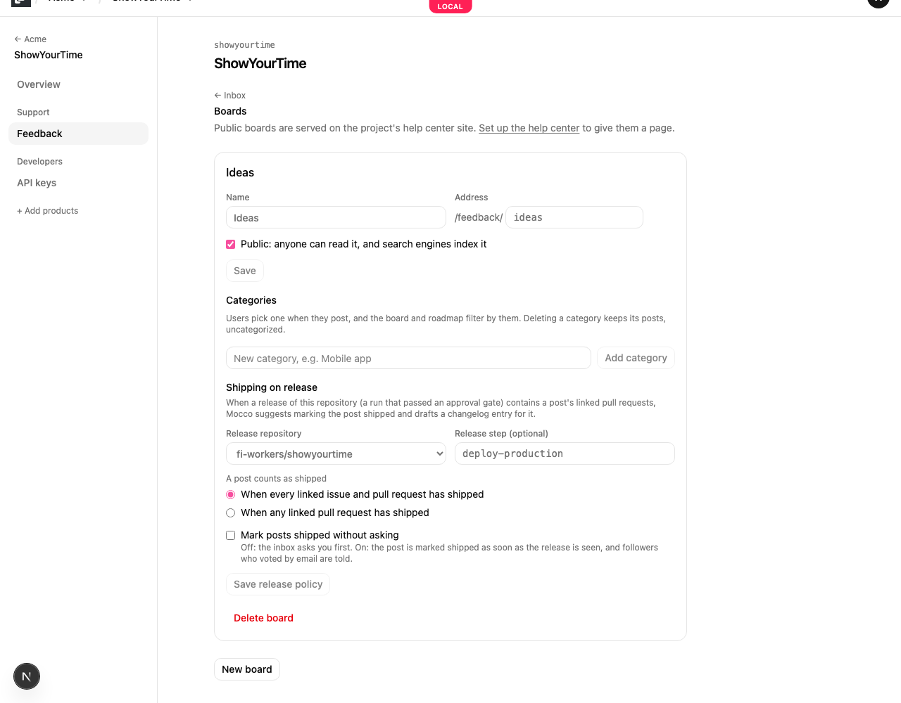

When a release contains a post's linked pull request (its merge commit is the released commit, or GitHub says the release includes it), the inbox shows a banner: how many posts the release shipped, the run they shipped in, and who approved it. **Mark shipped** moves them all to shipped, and followers who voted by email hear about it as with any status change. **Dismiss** leaves the posts as they are. Mocco also drafts a changelog entry listing the posts and their pull requests; **Draft changelog entry** opens it so you can edit and publish it.

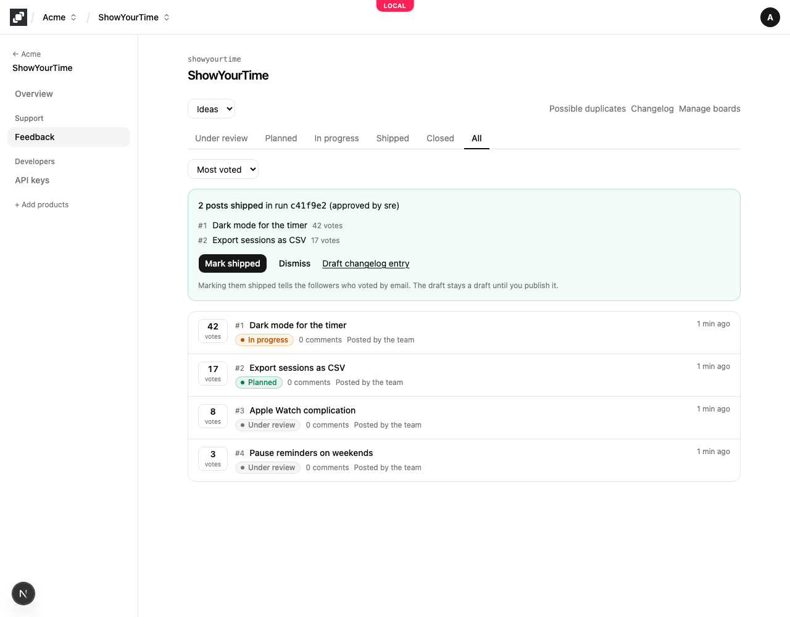

You don't have to keep the inbox open to see the banner. Mocco also sends a notification, `feedback.ship.suggested`, once per board and release: how many posts shipped, which ones, the release's commit, who approved it, and a link to the inbox. To receive it in a Discord channel, apply the **Mocco** preset on the channel's **Rules** in **Notifications**, which includes it, or add a rule for it by hand; the filter `board=<slug>` limits it to one board (see [Mocco events](../notifications/mocco-events.md#the-mocco-preset)).

If you'd rather not be asked, turn on **Mark posts shipped without asking**: Mocco then marks the posts shipped as soon as it sees the release, and the change shows in the post's history and the audit log as made by Mocco. It is off unless you turn it on. Mocco looks at a post's pull requests only in the release repository, so a post whose work also lands in another repository waits for that work under "every". Posts already shipped, merged into another post, or waiting on an earlier banner are left alone.

### Announce what shipped

**Changelog** in the inbox's header lists the board's entries: drafts, scheduled and published. Type a title and choose **New entry** to start one. In the entry, write what changed in Markdown (the preview shows it as readers will see it), tick New, Improved or Fixed, and add the posts it shipped. Then **Publish now**, or pick a time and **Schedule** it: Mocco publishes it within a minute of that time. A published entry can go back to a draft with **Unpublish**.

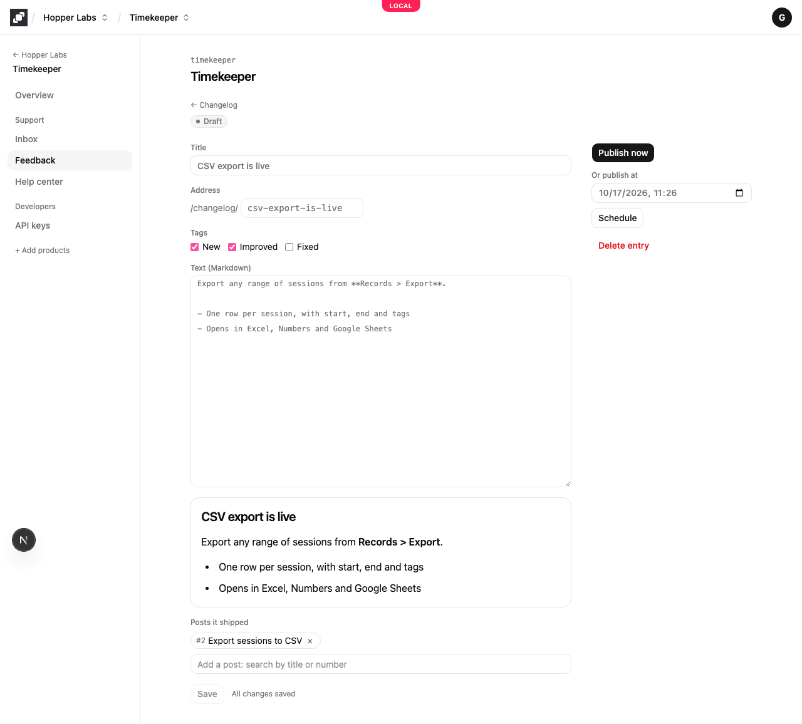

People who voted for a post by email hear when it ships, and that mail links the entry that announced it.

## 7. Limits

Each user can vote 30 times, comment 20 times and post 5 times an hour, and one network address can make 120 changes an hour, whoever signs in. An email address gets 3 vote mails an hour.

The list a search engine or a first-time visitor sees is refreshed at least once a minute. Vote counts on a post's page are always current.
