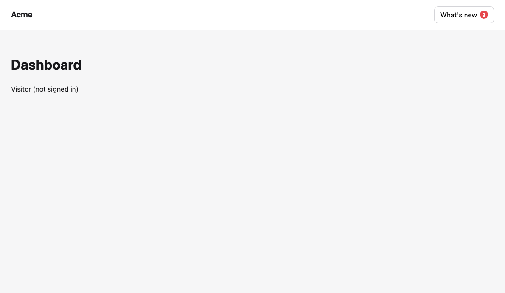
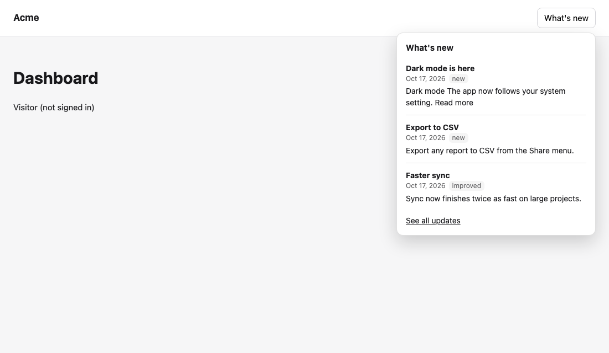

# Show what's new in your app

When your team publishes a changelog entry on a feedback board, your users should hear about it where they already are: in your app. The "what's new" badge counts the entries a user hasn't seen yet, and opening it shows the newest ones and resets the count.



## 1. Before you start

- A feedback board with published changelog entries (see [Open a public feedback board](./public-board.md)). The board must be public; the app reads it by its slug, such as `ideas`.
- A **publishable key** for the project (**Settings → API keys**) with `feedback:read`, and `feedback:write` if your users sign in (marking entries seen for a signed-in user is a write). A publishable key is safe to ship in an app.
- For a web app, its address registered as a **web origin** of a web app in the project (**Settings → Apps**), such as `https://app.acme.com`. Browsers refuse the API's answers to any other page.

## 2. Signed-in users and visitors

The badge works for everyone; what "seen" means depends on whether your app tells Mocco who the user is.

- **Signed in.** Your server signs a short-lived token for its signed-in user, the same token the [public board](./public-board.md#3-sign-your-users-in-from-your-app) uses: an HS256 JWT signed with the project's identity secret, with the user's id as `sub` and an expiry at most an hour ahead. Give the SDK a function that fetches one. Mocco then keeps the user's "last seen" itself, so opening the changelog on their phone clears the badge on the web too.
- **Visitors.** Without a token, the device keeps the date of the newest entry it has shown, in localStorage on the web or the storage you pass in React Native. A new device or a cleared browser counts every entry as new again.

The SDK asks your function for a token when it first needs one and asks again only when Mocco refuses it as expired. Return `null` while nobody is signed in. Call `whatsNew.feedback.resetEndUser()` when the user signs out or another one signs in.

## 3. On the web

Install the browser SDK:

```bash
npm install @mocco/js
```

Mount the widget on a button of your page. The button gets the unread count as a badge, and clicking it opens the newest entries in a small popover; opening it marks them seen.

```ts
import { createWhatsNew } from '@mocco/js/whats-new';

const whatsNew = createWhatsNew({
  publishableKey: 'mk_pub_…',
  board: 'ideas',
  // Leave out for visitors only. Return null while nobody is signed in.
  endUserToken: async () => {
    const response = await fetch('/api/mocco-token');
    return response.ok ? ((await response.json()) as { token: string }).token : null;
  },
});

whatsNew.mount('#whats-new', {
  // Optional: a link under the list, such as the board's public changelog.
  moreUrl: 'https://acme.help.mocco.club/feedback/ideas/changelog',
});
```



The popover shows each entry's title, date, tags and the first lines of its text as plain text (formatting, links and images are left out, so nothing in an entry runs as code on your page), and closes with Escape or a click outside it.

Options for `mount`:

| Option | What it does |
|---|---|
| `labels` | The widget's words: `title`, `loading`, `empty`, `error`, `more`, and `unread` (read by screen readers after the number) |
| `moreUrl` | A link under the list |
| `markSeenOnOpen` | `false` to mark entries seen yourself with `whatsNew.markSeen()` |
| `formatDate` | How an entry's date is shown (default: the browser's language, such as "Oct 17, 2026") |
| `onOpenChange` | Called with `true` or `false` when the popover opens or closes, for example for analytics |

`mount` returns a function that removes the badge and the popover again. To change the colors, set `--mocco-wn-accent` (the badge), `--mocco-wn-bg`, `--mocco-wn-fg` and `--mocco-wn-border` (the popover) on your page; the popover follows the system's dark mode by default.

Without the widget, draw your own: `await whatsNew.unreadCount()` answers the count, `whatsNew.markSeen()` clears it, and `whatsNew.client` has the entries (`loadEntries()`, `getState()`, `subscribe(listener)`).

The widget, with the client it needs, is about 5 KB gzipped in a bundled app; Mocco's checks keep it under 25 KB.

## 4. In React Native

Install the React Native SDK (it runs in Expo Go):

```bash
npx expo install @mocco/react-native @react-native-async-storage/async-storage
```

Create one `WhatsNew` for the app, outside your components, with AsyncStorage so a visitor's "last seen" survives a restart:

```ts
import AsyncStorage from '@react-native-async-storage/async-storage';
import { createWhatsNew } from '@mocco/react-native/whats-new';

export const whatsNew = createWhatsNew({
  publishableKey: 'mk_pub_…',
  board: 'ideas',
  storage: AsyncStorage,
  endUserToken: async () => await fetchMoccoTokenFromYourServer(),
});
```

Put the badge next to a menu item or tab. It draws nothing when there is nothing new, and refreshes when the app comes back to the foreground:

```tsx
import { WhatsNewBadge } from '@mocco/react-native/whats-new';

<WhatsNewBadge whatsNew={whatsNew} style={{ backgroundColor: '#4f46e5' }} />;
```

On the screen that lists the entries, `useWhatsNew` gives the data, and you draw the list in your app's design and language:

```tsx
import { useEffect } from 'react';
import { FlatList, Text } from 'react-native';
import { useWhatsNew } from '@mocco/react-native/whats-new';

export function WhatsNewScreen() {
  const { entries, markSeen } = useWhatsNew(whatsNew, { loadEntries: true });
  useEffect(() => {
    void markSeen().catch(() => undefined);
  }, []);
  return <FlatList data={entries} keyExtractor={entry => entry.id} renderItem={({ item }) => <Text>{item.title}</Text>} />;
}
```

An entry's `body` is Markdown. Render it with a Markdown component that doesn't run HTML, or show the title and date only.

## 5. Read posts and vote

The same key reads the board's posts, and a signed-in user can vote. On the web, use `@mocco/js/feedback`; in React Native, `FeedbackClient` from `@mocco/react-native/whats-new`.

```ts
import { createFeedback } from '@mocco/js/feedback';

const feedback = createFeedback({ publishableKey: 'mk_pub_…', endUserToken: fetchMoccoToken });
const board = feedback.board('ideas');

const { posts } = await board.posts({ sort: 'top', limit: 20 });
await feedback.vote(posts[0].id); // voting again changes nothing; feedback.unvote(id) takes it back
const { viewer } = await feedback.post(posts[0].id); // viewer.vote: 'counted' once they voted
```

Voting without a signed-in user is refused with a `MoccoError` whose `code` is `missing_end_user_token`, before anything is sent. To let users post ideas, comment and follow from the app, or to open a ready-made sheet of ideas, see [Collect ideas in your app](./in-app-ideas.md).

## 6. Limits

A signed-in user can mark the changelog seen 120 times an hour, which a widget opened often stays well under. The unread count stops at 100.
