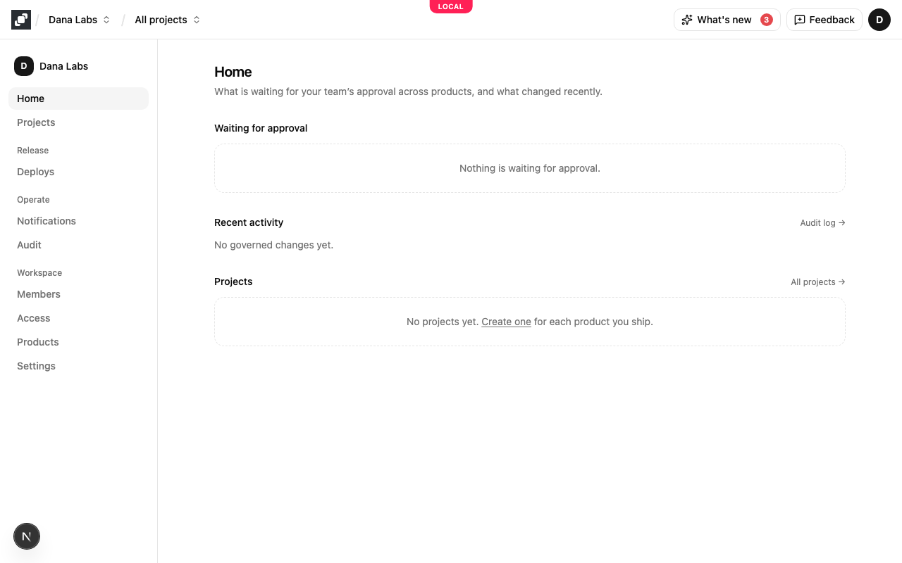
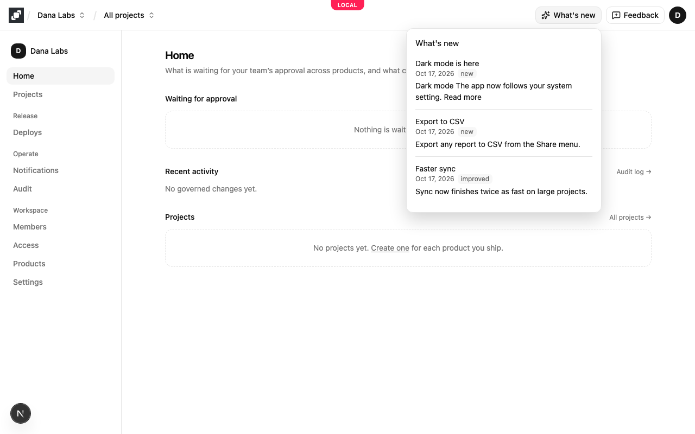
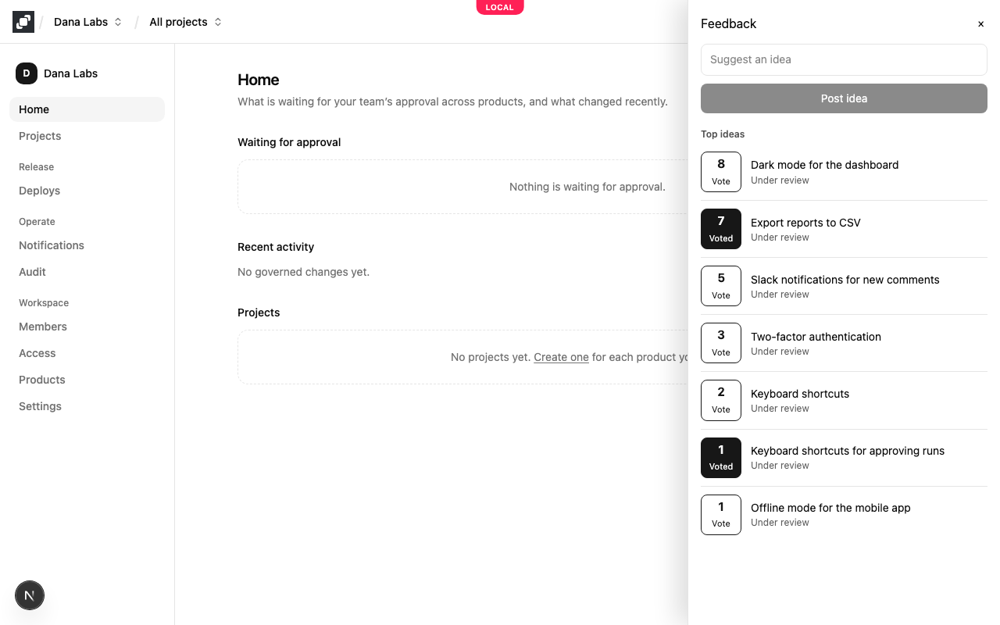

# Mocco on Mocco

The console tells its users what changed in Mocco and collects their ideas with Mocco's own feedback product. Mocco
runs as a customer of itself: a Mocco project holds Mocco's feedback board and changelog, and the console's header
mounts the same `@mocco/js` widgets a customer puts in their app (see [Show what's new in your app](../customer/feedback/whats-new.md)
and [Collect ideas in your app](../customer/feedback/in-app-ideas.md)). Every rough edge a customer would hit, the team
hits first.

## What the console shows

With the env below set, the header has two buttons left of the account menu:

- **What's new** carries the unread badge. Clicking it opens the newest changelog entries in a popover and marks them
  seen for the signed-in user, so the badge clears on every device they use.
- **Feedback** opens the feedback sheet: the board's most voted ideas, a vote button on each (showing **Voted** for the
  user's earlier votes), and a box to post an idea with similar ideas suggested while they type.

The popover and sheet take the console's colors (`--mocco-wn-*` and `--mocco-fs-*` set to the console's tokens in
`globals.css`) instead of following the system's dark mode. On a phone-sized screen the buttons show their icons only;
the labels stay for screen readers. Both are plain buttons: Tab reaches them, Enter or Space opens them, and Escape
closes the popover or sheet and puts focus back on the button.

## Who the user is

The signed-in console user takes part as an end user of Mocco's project, identified the way any customer identifies
theirs: an HS256 token signed with the project's identity secret, with the user's id as `sub`.

`GET /api/self/end-user-token` (same origin, `pages/api/self/end-user-token.ts`) signs that token. It answers:

| Case | Answer |
|---|---|
| `MOCCO_SELF_IDENTITY_SECRET` unset | 404; the widgets then work as for a visitor (read-only sheet, a badge kept in localStorage) |
| No console session | 401 |
| Signed in | 200 `{ token, expiresAt }`: `sub` = the user's Mocco id, valid for ten minutes |

The answer is `Cache-Control: no-store` and the token is never logged. The SDK asks for a new token when Mocco refuses
one as expired. The user id is the only claim, so Mocco's project learns nothing about a console user but the id: it is
stored as the end-user id of their votes, posts and changelog reads, never a name or an email.

## How the widgets load

The console's own bundle doesn't include the widgets. `MoccoSelfWidgets` (`components/mocco-self-widgets.tsx`) renders
the two buttons and loads each widget with a dynamic `import()`:

- `@mocco/js/whats-new` when the browser is idle after the page loads (`requestIdleCallback`, at most three seconds),
  because the badge needs the unread count.
- `@mocco/js/feedback-sheet` when the user hovers, focuses or presses **Feedback**. A press before the code arrives
  opens the sheet as soon as it has loaded.

The token fetcher (`lib/mocco-self-token.ts`, which parses the route's answer with zod) loads with them, so
`configure.ts`, which every page loads, stays free of zod. Measured on a production build: the console's first load
grows by about 2 KB gzipped (the two buttons and the loader); the "What's new" chunk is about 5 KB and the sheet's about
6 KB gzipped, fetched only as described above.

Without `MOCCO_SELF_PUBLISHABLE_KEY` or `MOCCO_SELF_BOARD`, the component renders nothing and loads nothing.

The frontend's `dev` and `build` scripts build `@mocco/sdk-core` and `@mocco/js` first, since Next.js imports their
built files.

## Env

| Variable | Where | What it is |
|---|---|---|
| `MOCCO_SELF_PUBLISHABLE_KEY` | Browser (public) | A publishable key of Mocco's own project with `feedback:read` and `feedback:write` |
| `MOCCO_SELF_BOARD` | Browser (public) | The slug of that project's public feedback board |
| `MOCCO_SELF_API_URL` | Browser (public), optional | The `/v1` base the widgets call. Unset: the console's own origin plus `/api/ext/v1`, so nothing is cross-origin |
| `MOCCO_SELF_IDENTITY_SECRET` | Server only (sensitive) | That project's identity secret, which signs the console user's token |

`next.config.ts` hands the three public values to the browser as `NEXT_PUBLIC_MOCCO_SELF_*` at build time, so changing
them needs a new build. The widgets are host-agnostic: they call whichever Mocco serves the API URL, and the board's
public pages can be served
wherever the project serves them. See [Env management](./env.md#mocco-on-mocco-vars).

## Setting it up in production

1. In an operator workspace, create a project for Mocco itself (or use the existing one), enable **Feedback**, and
   create a **public** board, such as `mocco`. Publish at least one changelog entry.
2. In the project's **Settings → Apps**, add a web app whose web origins include `https://www.mocco.club`. The
   widgets' writes carry the console's `Origin`, and the API refuses origins the project doesn't list.
3. In **Settings → API keys**, create a **publishable** key with `feedback:read` and `feedback:write`.
4. Get the project's identity secret: setting up the project's messenger creates it and shows it once. If it was
   lost, rotate it in the messenger's settings, which shows the new one once (and refuses tokens signed with the old
   one, so update the env right away).
5. Set `MOCCO_SELF_PUBLISHABLE_KEY`, `MOCCO_SELF_BOARD` and `MOCCO_SELF_IDENTITY_SECRET` (sensitive) in the
   deployment's env, leave `MOCCO_SELF_API_URL` unset, and redeploy.
6. Check: sign in to the console, see the badge count the published entries, open the popover (the badge clears), open
   **Feedback**, vote and post, then reload and see **Voted**. The posted idea's end-user author is the console user's
   Mocco id.

To turn it off, unset the key or the board and redeploy.
